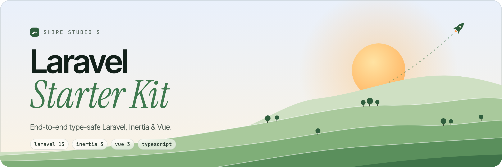

<picture>
    <source media="(prefers-color-scheme: dark)" srcset="art/header-dark.png">
    
</picture>

<br/>
<br/>

<p>
    <a href="https://github.com/shire-studio/laravel-starter-kit-api/actions"></a>
    <a href="https://packagist.org/packages/shire-studio/laravel-starter-kit-api"></a>
    <a href="LICENSE.md"></a>
</p>

A strict, fully tested Laravel 13 API starter kit with Sanctum token authentication and JSON resources. It shares its actions, form requests and models with the other Shire Studio starter kits, so the same application logic answers with JSON instead of pages.

## Tech Stack

**Backend:** PHP 8.5+, Laravel 13, Laravel Sanctum, Nuno Maduro's Essentials

**Code quality:** PHPStan (level max via Larastan), Rector, Pint, Pest v5 (100% coverage)

## Endpoints

| Method | Path | Purpose |
| --- | --- | --- |
| `POST` | `/register` | Create an account and receive a token |
| `POST` | `/login` | Exchange credentials for a token |
| `POST` | `/logout` | Revoke the current token |
| `POST` | `/forgot-password` | Email a password reset link |
| `POST` | `/reset-password` | Reset a password with a token from the email |
| `GET` | `/user` | Show the authenticated user |
| `PATCH` | `/user` | Update the name and email |
| `DELETE` | `/user` | Delete the account (requires the current password) |
| `PUT` | `/user/password` | Change the password |
| `POST` | `/email/verification-notification` | Resend the verification email |
| `GET` | `/email/verify/{id}/{hash}` | Verify the email address (signed) |

Send the token as `Authorization: Bearer <token>`. Every response, including errors, is JSON. Password reset emails link to `FRONTEND_URL`, so point it at the client that collects the new password.

## Local Development

> **Requires [PHP 8.5+](https://php.net/releases/) and a code coverage driver such as [Xdebug](https://xdebug.org/docs/install).** `composer dev` also uses Node to run its processes side by side.
>
> SQLite is used by default for the database, cache and queue.

```bash
composer create-project shire-studio/laravel-starter-kit-api --prefer-dist example-app
cd example-app

# Install dependencies, create .env, generate a key and migrate
composer setup

# Start the server, queue worker and logs
composer dev
```

## Available Commands

- `composer dev` starts the app with Laravel's `artisan dev` process runner
- `composer lint` runs Rector and Pint and fixes what it can
- `composer test:lint` checks formatting without changing files
- `composer test:types` runs PHPStan
- `composer test:type-coverage` enforces 100% type coverage
- `composer test:unit` runs Pest with the 100% code coverage requirement
- `composer test` runs all of the above
- `composer update:requirements` bumps every PHP dependency to its latest version

## Code Standards

- **Actions oriented architecture:** every operation lives in a single action class under `app/Actions`
- **Cruddy by design:** controllers stick to resourceful methods
- **Immutable first:** data structures favour immutability to prevent unexpected mutations
- **Fail fast:** strict static analysis catches errors before runtime
- **Strict Laravel defaults:** strict models, automatic eager loading and immutable dates via [Essentials](https://github.com/nunomaduro/essentials)
- **AI guidelines:** the rules in `.ai/rules` keep generated code consistent with the rest of the codebase

## Testing

The project uses [Pest](https://pestphp.com) and enforces:

- **100% code coverage:** the suite fails if coverage drops below 100%
- **100% type coverage:** every method, property and parameter is explicitly typed
- **Static analysis:** PHPStan at level max

Run the full suite with:

```bash
composer test
```

## Releasing

Releases are published by the **release** workflow, not from the Releases page. In the Actions tab, run it on `main` with the new version, for example `v1.5.0`.

The workflow writes the version to `.starter-kit.json`, commits it on top of `main`, tags that commit and publishes a GitHub release with generated notes. Every project created from the release then knows which version it started from, which the [starter kit CLI](https://github.com/shire-studio/laravel-starter-kit-cli) uses to update it later. The release commit is only reachable from its tag, so `main` itself never has a `.starter-kit.json`.

## Contributing

This repository is raised by [Hobbiton](https://github.com/shire-studio/hobbiton), which grows every Shire Studio starter kit from shared smials. Please open issues and pull requests there, so a fix reaches every kit.

## License

This project was created by **Shire Studio** under the **[MIT license](LICENSE.md)**.
